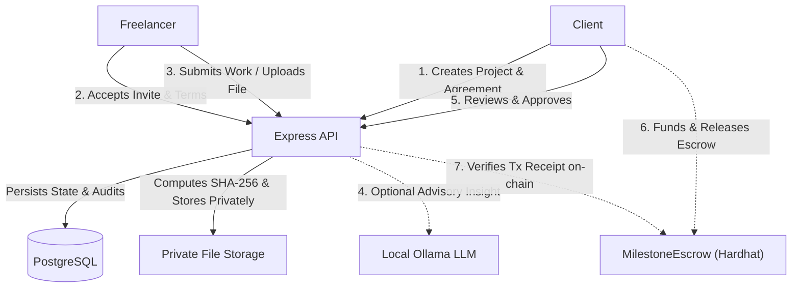

# Fairwork

> A portable project-protection layer for freelance work — agreements, milestone evidence, advisory AI insights, dispute resolution, and escrow payment tracking.
> **Tagline:** *"Get paid for what you deliver."*

**Team:** Arvin Almeida · Anto Oswald · Cyrus Selvaraj · Brendan Rodrigues


---

## Overview

Fairwork protects both freelancers and clients from common contracting risks without forcing them into a walled-garden marketplace. Freelancers risk non-payment after completing work, clients risk paying for incomplete or sub-par deliverables, and traditional escrow platforms impose high fees and slow dispute cycles. Fairwork provides a lightweight agreement layer where parties define milestones, log cryptographic proof of work, receive advisory AI assessments, and settle disputes with human arbitrators and verifiable escrow receipts.

---

## Key Features

- **Project Creation & Invitations:** Clients create projects, set optional external reference URLs, and generate shareable invitation links for freelancers to join.
- **Milestone Agreements with Versioning:** Define deliverables, deadlines, review windows, and amounts in cents. Changing terms requires mutual acceptance and creates a new version (`PROPOSED`, `ACTIVE`, `SUPERSEDED`, `WITHDRAWN`).
- **Standardized Milestone State Machine:** Explicit status vocabulary enforcing role permissions (`PENDING`, `IN_PROGRESS`, `SUBMITTED`, `IN_REVIEW`, `REVISION_REQUESTED`, `APPROVED`, `DISPUTED`).
- **Delivery Proof & Audit History:** Freelancers submit URLs and/or private files. The server computes SHA-256 hashes on upload and maintains immutable audit logs.
- **Advisory AI Progress Insights:** Evaluates deliverables against criteria using local Ollama models (`qwen2.5-coder:1.5b`, `qwen3:1.7b`, `qwen2.5vl:3b`). AI output is strictly advisory and fails safely if models are unavailable.
- **Deterministic Protection Alerts:** Automated, rule-based background jobs scan for approaching deadlines and inactive milestones, surfacing alerts via the header notifications bell without relying on AI judgment.
- **Human-Governed Dispute Resolution:** Parties open disputes with private evidence. Seeded arbitrators claim cases and record binding rulings (`RELEASE_TO_FREELANCER`, `REFUND_TO_CLIENT`, `SPLIT`) without automatically moving funds.
- **Escrow Payment Verification:** Track and verify funding, releases, and refunds against a local Hardhat ERC-20 escrow contract using transaction hashes and on-chain event receipts.

---

## Pages and Routes

| Route | Page Name | Purpose |
|---|---|---|
| `/` | `HomePage` | Public landing page explaining the problem, workflow, features, and dispute system. |
| `/login` | `LoginPage` | User login with email and password. |
| `/register` | `RegisterPage` | User registration for `CLIENT` or `FREELANCER` roles. |
| `/invite/:token` | `InvitePage` | Preview project details and accept an invitation as an authenticated freelancer. |
| `/dev/ui` | `UiDemoPage` | Developer showcase for typography, buttons, inputs, panels, badges, and modals. |
| `/dashboard` | `DashboardPage` | Authenticated home view listing active projects and quick actions. |
| `/projects` | `ProjectsPage` | Full project list view filtered by user participation. |
| `/projects/new` | `NewProjectPage` | Form for clients to create new projects and define scope. |
| `/projects/:projectId` | `ProjectDetailPage` | Project summary, participant status, external URL links, and invitation generator. |
| `/projects/:projectId/agreement` | `AgreementPage` | Agreement drafting, revision history, and mutual acceptance status. |
| `/projects/:projectId/progress` | `ProgressPage` | Milestone lifecycle manager, deliverable submission, review actions, and advisory AI analysis. |
| `/projects/:projectId/disputes` | `DisputesPage` | Dispute case view, private evidence upload, arbitrator claim/decision panel, and AI summary. |
| `/projects/:projectId/payments` | `PaymentsPage` | Escrow transaction reporting and on-chain verification tracking. |

---

## User Roles

| Role | Permissions & Capabilities |
|---|---|
| **Client** | Create projects, invite freelancers, draft/propose agreement terms, accept agreements, start reviews on submissions, approve work or request revisions, open disputes, and fund/release escrow payments. Cannot approve their own submissions. |
| **Freelancer** | Accept project invitations, accept agreements, start work on milestones, submit deliverables (links and/or private files), view review feedback, and open disputes. Cannot create projects, approve milestones, or decide disputes. |
| **Arbitrator** | Seeded administrative role (cannot self-register). Access disputed projects, claim open disputes, inspect private evidence and AI summaries, and record resolution rulings. Cannot unilaterally move escrow funds. |

---

## Tech Stack

| Layer | Technologies |
|---|---|
| **Frontend** | React 19, TypeScript, Vite 8, Tailwind CSS v4, Lucide React, React Router v7 |
| **Backend API** | Node.js (>=20), Express 5, PostgreSQL (`pg` pool), Bcryptjs, JsonWebToken, Multer, Helmet, CORS, Zod |
| **Smart Contracts** | Solidity 0.8.20, Hardhat 2, OpenZeppelin Contracts v5 (`IERC20`, `SafeERC20`, `ReentrancyGuard`), Ethers.js v6 |
| **Database** | PostgreSQL 16 (runs via Docker Compose or native) |
| **AI (Local / Optional)** | Ollama HTTP API (`qwen2.5-coder:1.5b`, `qwen3:1.7b`, `gemma3:1b`, `qwen2.5vl:3b`, `gemma3:4b`) |

---

## Project Structure

```text
.
├── backend/                  # Express 5 REST API and PostgreSQL data access
│   ├── src/
│   │   ├── config/           # Environment variables, AI settings, storage configuration
│   │   ├── db/               # PostgreSQL connection pool and SQL migrations (001–008)
│   │   ├── middleware/       # JWT authentication, role authorization, error handling
│   │   ├── modules/          # Domain modules (auth, projects, agreements, milestones, submissions, disputes, payments, ai, notifications)
│   │   └── utils/            # Async handlers, error types, SHA-256 hash helpers
│   ├── storage/              # Local disk storage for private submissions and evidence
│   └── tests/                # Unit and integration test suites (Vitest + Supertest)
├── contracts/                # Hardhat environment for escrow smart contracts
│   ├── contracts/            # MilestoneEscrow.sol and MockERC20.sol
│   ├── scripts/              # deploy-local.js deployment script for local Hardhat node
│   └── test/                 # Hardhat and Mocha contract test suites
├── frontend/                 # React 19 + TypeScript single-page application
│   ├── public/               # Favicon and static assets
│   └── src/
│       ├── auth/             # React authentication context and route guards
│       ├── components/       # Design system UI primitives (Panel, Badge, Button, Modal, etc.)
│       ├── lib/              # API clients, status mappings, and route definitions
│       ├── pages/            # Page components matching application routes
│       └── styles/           # Tailwind CSS design tokens
└── docs/                     # Architecture specifications, demo guides, and design inventory
```

---

## Getting Started

### Prerequisites

- **Node.js:** `>= 20.0.0` (tested on `v22.23.2`)
- **npm:** `>= 10.0.0` (tested on `10.9.8`)
- **Docker & Docker Compose** (or native PostgreSQL 16)
- **Ollama** (optional, for local AI insights)

### Environment Variables

#### Backend (`backend/.env`)

| Variable | Purpose | Required |
|---|---|---|
| `DATABASE_URL` | PostgreSQL connection string | Yes |
| `JWT_SECRET` | Secret key for signing authentication tokens | Yes |
| `PORT` | API server port (default: `4000`) | No |
| `NODE_ENV` | Environment mode (`development`, `test`, `production`) | No |
| `JWT_EXPIRES_IN` | Token expiration duration (default: `7d`) | No |
| `CORS_ORIGIN` | Allowed client origin (default: `http://localhost:5173`) | No |
| `STORAGE_PRIVATE_DIR` | Private file upload root (defaults to `backend/storage/private`) | No |
| `MAX_UPLOAD_BYTES` | Upload limit in bytes (default: `10485760` / 10 MiB) | No |
| `CHAIN_ID` | EVM network ID for escrow (default: `31337`) | For payments |
| `RPC_URL` | EVM RPC endpoint (default: `http://127.0.0.1:8545`) | For payments |
| `ESCROW_CONTRACT_ADDRESS` | Deployed `MilestoneEscrow` contract address | For payments |
| `TOKEN_DECIMALS` | ERC-20 token decimals (default: `6`) | No |
| `AI_ENABLED` | Enable advisory AI assessments (default: `true`) | No |
| `OLLAMA_BASE_URL` | Local Ollama API URL (default: `http://127.0.0.1:11434`) | No |
| `NOTIFICATION_JOB_ENABLED` | Run deadline and inactivity background jobs (default: `true`) | No |

#### Frontend (`frontend/.env`)

| Variable | Purpose | Required |
|---|---|---|
| `VITE_API_BASE_URL` | Backend origin URL without trailing slash (e.g. `http://localhost:4000`) | Yes |

---

### Installation & Running

#### 1. Database & Backend

```bash
cd backend
docker compose up -d          # Starts PostgreSQL on host port 5434
cp .env.example .env          # Set JWT_SECRET and verify DATABASE_URL
npm install
npm run migrate               # Applies migrations 001 through 008
npm run dev                   # Starts API at http://localhost:4000
```

#### 2. Frontend

```bash
cd frontend
cp .env.example .env          # Points VITE_API_BASE_URL to http://localhost:4000
npm install
npm run dev                   # Starts Vite at http://localhost:5173
```

#### 3. Smart Contracts (Optional — For Local Payment Verification)

```bash
cd contracts
npm install
npx hardhat node              # Terminal A: Starts local EVM chain on :8545
npx hardhat run scripts/deploy-local.js --network localhost   # Terminal B
```

Copy the deployed `MilestoneEscrow` address to `backend/.env` as `ESCROW_CONTRACT_ADDRESS` and restart the backend.

---

### Verification and Testing

```bash
# Run backend test suite (PostgreSQL must be running)
cd backend && npm test

# Run frontend type checking, linter, and production build
cd frontend && npm run lint && npm run build

# Run smart contract test suite
cd contracts && npm test
```

---

## How It Works



1. **Agree:** Client creates a project, invites a freelancer, and drafts milestone terms. Both parties accept before the agreement becomes `ACTIVE`.
2. **Deliver:** The freelancer moves milestones to `IN_PROGRESS` and uploads deliverables (links and/or private files). The backend computes a SHA-256 hash on file upload.
3. **Review & AI Insight:** The client reviews deliverables. Either party can request an advisory AI assessment that evaluates criteria against evidence without making binding decisions.
4. **Settle or Dispute:** The client approves the work or requests a revision. If a dispute is raised, an arbitrator reviews evidence and records a decision. Payments are funded and released on-chain, and receipts are verified by transaction hash.

---

## Important Limitations and Notices

- **Testnet/Local Payments Only:** Escrow functionality is designed for local Hardhat EVM development and test tokens. It is not connected to Ethereum mainnet or custodial wallets.
- **AI Output Is Strictly Advisory:** Models never release funds, approve milestones, or decide disputes. If Ollama is offline or models are unpulled, assessments fail safely with `MODEL_UNAVAILABLE`.
- **File Hashes Verify Integrity, Not Quality:** The server-computed SHA-256 hash proves that submitted bytes were not altered after upload; it does not guarantee that the deliverable meets client quality expectations.
- **External URLs Are References:** Links to GitHub, Figma, or freelance platforms are metadata references and do not represent automated marketplace integrations.

---

## Roadmap and Known Gaps

- **Auth Rate Limiting:** `express-rate-limit` is included as a backend dependency but is not yet wired to authentication endpoints.
- **Arbitrator Account Registration:** Arbitrator accounts cannot be created via the public UI and must be manually seeded in PostgreSQL.
- **Cryptographic Signatures:** Agreement acceptances record user IDs and optional signature references; full wallet cryptographic message signing is not yet implemented.
- **E2E Browser Tests:** Testing currently relies on API integration tests (Supertest) and unit tests; Playwright/Cypress end-to-end browser suites are not included.

---

## Contributing and License

- **Contributing:** This repository is part of a hackathon MVP. Open an issue or submit a pull request with proposed changes.
- **License:** The smart contracts are licensed under the [MIT License](contracts/package.json).
