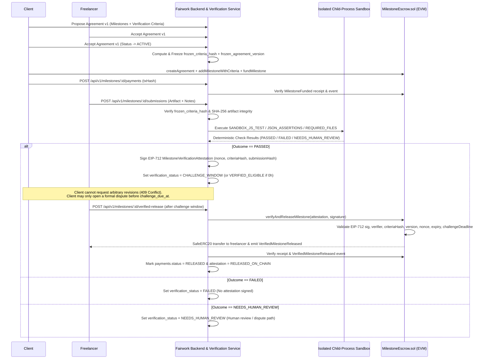

# Verifiable Milestone Fulfilment & Smart-Contract-Enforced Release Architecture

## 1. Executive Summary & Objective

Previously, Fairwork's milestone settlement workflow relied on either:
1. **Explicit client approval** (`POST /api/v1/submissions/:id/review` with `decision = 'APPROVED'` or `MilestoneEscrow.releaseMilestone`), or
2. **Client silence** after a passive review window (`autoApproveDueMilestones` / `MilestoneEscrow.autoReleaseMilestone`).

Under that model, an adversarial or uncooperative client could repeatedly request revisions or refuse to click **Approve** even when a freelancer had satisfied all agreed, objective milestone requirements.

The **Verifiable Milestone Fulfilment** architecture shifts payment eligibility from **arbitrary client approval** to **pre-agreed, cryptographically frozen milestone conditions**:

$$\text{Agreement} \rightarrow \text{Escrow Funding} \rightarrow \text{Deliverable Submission} \rightarrow \text{Independent Verification} \rightarrow \text{Signed EIP-712 Attestation} \rightarrow \text{Smart Contract Validation} \rightarrow \text{On-Chain Release}$$

- **Objective requirements** (`AUTOMATED_CHECK`, `EVIDENCE_INTEGRITY_CHECK`) are evaluated independently by the verification orchestrator. When a deliverable passes all configured objective checks, the client **cannot** unilaterally request a revision (`409 Conflict`) or unilaterally refund/reclaim the milestone on-chain.
- **Bounded challenge window:** After an objective `PASSED` attestation is issued, a configurable challenge window (`challenge_window_hours`, default `48h`, or `0h` for immediate release) allows the client to raise a formal dispute with specific criteria references if they allege fraud or sandbox manipulation. Once the challenge window expires without an open dispute, **the freelancer, operator, or relayer can trigger smart-contract release directly without client approval**.
- **Subjective requirements** (`HUMAN_REVIEWED`) never receive a fabricated automated pass/fail verdict. The verifier explicitly returns `NEEDS_HUMAN_REVIEW` and preserves the structured review and bounded dispute-escalation workflow (`dispute_escalation_days`).

---

## 2. Phase 1 Repository Inspection Findings (Baseline vs. Target)

### 2.1 Execution Path Mapping

| Workflow Stage | Existing Implementation (Baseline) | Verifiable Milestone Extension (Added) |
| --- | --- | --- |
| **Agreement Proposal & Acceptance** | `agreement.service.js`: `proposeAgreement`, `acceptAgreement` | Normalizes per-milestone verification criteria (`verificationMethod`, `verificationCriteria`, `challengeWindowHours`, `disputeEscalationDays`). When both parties accept the same version (`ACTIVE`), computes and freezes `frozen_criteria_hash` (`keccak256` over canonical JSON) and `frozen_agreement_version` on each milestone. Amendments preserve frozen criteria on already-submitted milestones. |
| **Escrow Funding (On-Chain)** | `MilestoneEscrow.sol`: `createAgreement`, `addMilestone`, `fundMilestone`; `payment.service.js`: `reportPayment` verifies `MilestoneFunded` event via `escrowVerifier.js` | `MilestoneEscrow.sol` adds `addMilestoneWithCriteria` and `setMilestoneVerificationCriteria` to bind `criteriaHash`, `requiredAgreementVersion`, and `challengeWindowSeconds` on-chain. |
| **Gateway Funding (Off-Chain Sandbox)** | `funding.service.js`: `createFundingOrder`, `verifyFundingPayment`, `releaseMilestonePayment` (`project_funding`, `milestone_funds`, `payout_records`) | Strictly separated from on-chain escrow (`payments` table). Gateway funding is never represented as an on-chain deposit, and simulated payouts are never represented as real bank transfers or blockchain transactions. |
| **Deliverable Submission** | `submission.service.js`: `createSubmission` hashes uploaded files (`sha256_hash`) and transitions milestone to `SUBMITTED` | Automatically invokes `evaluateSubmissionVerification(submission.id)` in `verification.service.js` after submission creation. Rejects stale submission revisions. |
| **Independent Verification** | *Did not exist* | `verification.runner.js` + `verification.sandbox.js`: Validates required evidence, SHA-256 artifact integrity, deterministic JSON/text/file checks, and isolated child-process JS test suites (`SANDBOX_JS_TEST`). Persists immutable `verification_runs` rows. |
| **Signed Attestation** | *Did not exist* | `verification.attestation.js`: Issues EIP-712 `MilestoneVerificationAttestation` signed by an authorized verifier key only when `outcome === 'PASSED'`. Persists in `verification_attestations`. |
| **Smart-Contract Release** | `MilestoneEscrow.sol`: `releaseMilestone` (client-only) or `autoReleaseMilestone` | `MilestoneEscrow.sol`: `submitVerificationAttestation`, `releaseVerifiedMilestone`, and `verifyAndReleaseMilestone` validate the EIP-712 signature, authorized verifier, domain separator, `criteriaHash`, `agreementVersion`, `outcome == 1`, `expiresAt`, unused `nonce`, and `challengeDeadline` before transferring ERC-20 tokens via `SafeERC20`. |

### 2.2 PostgreSQL vs. Smart Contract State Model

- **PostgreSQL `milestones.status`:** `PENDING`, `IN_PROGRESS`, `SUBMITTED`, `UNDER_REVIEW`, `REVISION_REQUESTED`, `APPROVED`, `DISPUTED`, `CANCELLED`.
- **PostgreSQL `milestones.verification_status`:** `NONE`, `PENDING`, `PASSED`, `FAILED`, `NEEDS_HUMAN_REVIEW`, `CHALLENGE_WINDOW`, `VERIFIED_ELIGIBLE`.
- **PostgreSQL `payments.status` (On-Chain Escrow Ledger):** `PENDING`, `CONFIRMED`, `RELEASED`, `REFUNDED`, `FAILED`. Updated **only** after `escrowVerifier.js` verifies the on-chain transaction receipt and contract log (`MilestoneFunded`, `MilestoneReleased`, `VerifiedMilestoneReleased`, `MilestoneRefunded`, `DisputeResolved`).
- **PostgreSQL `milestone_funds.allocation_status` (Gateway Sandbox Ledger):** `ALLOCATED`, `ELIGIBLE`, `RELEASED`, `REFUNDED`, `FROZEN_DISPUTE`.
- **Solidity `MilestoneEscrow.MilestoneState`:** `None (0)`, `Pending (1)`, `Funded (2)`, `Released (3)`, `Refunded (4)`, `Disputed (5)`, plus per-milestone verification state (`verificationPassed`, `verifiedSubmissionHash`, `verifiedNonce`, `verifiedAt`, `challengeDeadline`).

---

## 3. Component Architecture & Sequence Flow



---

## 4. Verification Criteria Model & Freezing Rules

Each milestone defines:
- **`verificationMethod`:**
  1. `AUTOMATED_CHECK` — Objective software/data checks evaluated automatically (`SANDBOX_JS_TEST`, `JSON_ASSERTIONS`, `TEXT_PATTERNS`, `REQUIRED_FILES`).
  2. `EVIDENCE_INTEGRITY_CHECK` — Cryptographic SHA-256 verification of the uploaded deliverable against required file constraints and expected hash commitments. *(Note: File hashes prove byte-level integrity and non-repudiation, not software quality or subjective correctness.)*
  3. `HUMAN_REVIEWED` — Subjective deliverables (e.g., visual design, UX copy, architecture prose) that require human review and cannot be automatically judged.
- **`verificationCriteria` (JSONB):**
  - `acceptanceCriteria`: Array of explicit requirement statements.
  - `requiredEvidence`: `{ requireFile, requireUrl, requireNotes, allowedExtensions, allowedContentTypes, minSizeBytes, maxSizeBytes, expectedSha256 }`.
  - `automatedChecks`: Array of deterministic check specifications (`SANDBOX_JS_TEST`, `JSON_ASSERTIONS`, `TEXT_PATTERNS`, `REQUIRED_FILES`).
  - `humanReviewChecklist`: Explicit subjective review items.
  - `disputeResolutionRule`: Escalation policy text.
- **Deadlines & Limits:**
  - `challengeWindowHours` (`0` to `720` hours, default `48`).
  - `disputeEscalationDays` (`1` to `90` days, default `7`).
  - `maxRevisions` (`1` to `20`, default `3`).

### Freezing & Amendment Invariant
When both parties accept an agreement version (`status = 'ACTIVE'`), `computeFrozenCriteriaHash` canonicalizes the milestone's verification parameters (`agreementVersion`, `milestoneNumber`, `title`, `deliverableDescription`, `amount`, `verificationMethod`, `verificationCriteria`, `maxRevisions`, `challengeWindowHours`) by recursively sorting all object keys and computing `keccak256(toUtf8Bytes(canonicalJson))`.
- The resulting `0x`-prefixed 32-byte digest is stored in `milestones.frozen_criteria_hash` along with `milestones.frozen_agreement_version`.
- If an agreement is later amended (`version = 2`), any milestone that already has submissions (`submissionCount > 0` or status beyond `IN_PROGRESS`) **retains its frozen criteria and version from the version under which work was submitted**, preventing retroactive requirement tampering.
- Before running verification, `resolveAndValidateFrozenCriteria` recomputes the canonical hash and throws `409 Conflict` if the database criteria diverge from `frozen_criteria_hash`.

---

## 5. Isolated Sandbox Execution Security (`verification.sandbox.js`)

When `AUTOMATED_CHECK` includes a `SANDBOX_JS_TEST` check:
1. **Separate OS Process:**Submitted code is never evaluated inside the Express server process. `runSandboxedJsTests` spawns a dedicated Node.js child process with `stdio: ['pipe', 'pipe', 'pipe']`.
2. **Zero Environment Leakage:** The child process runs with `env: { NODE_ENV: 'production', PATH: '' }` — no database URLs, JWT secrets, verifier private keys, or payment credentials exist in the child process environment.
3. **Memory & CPU Ceilings:** The child process is launched with `--max-old-space-size=64` (64 MB heap cap), `--disallow-code-generation-from-strings` (blocks `eval` and `new Function` inside V8), and a strict wall-clock kill timer (`timeoutMs`, capped between `200ms` and `5000ms`) that sends `SIGKILL` if exceeded.
4. **Null-Prototype VM Context:** Inside the child process, the deliverable is executed via `node:vm` inside a frozen, null-prototype context containing only deterministic ECMAScript built-ins (`Math`, `JSON`, `Array`, `Object`, `String`, `Number`, `Boolean`, `Date`, `RegExp`, `Map`, `Set`, `Error`, `Uint8Array`). `require`, `process`, `fs`, `net`, `http`, `fetch`, `child_process`, and `globalThis` host references are absent.
5. **Isolated Temp Working Directory:** The child process runs with `cwd` set to an ephemeral directory created via `fs.mkdtemp` and removed immediately in `finally`.

---

## 6. Signed Verification Attestations (`MilestoneVerificationAttestation`)

### 6.1 EIP-712 Domain & Struct Type
- **Domain:**
  ```json
  {
    "name": "FairworkMilestoneEscrow",
    "version": "1",
    "chainId": 31337,
    "verifyingContract": "0x..."
  }
  ```
- **Primary Type (`MilestoneVerificationAttestation`):**
  ```solidity
  struct VerificationAttestation {
      uint256 agreementId;
      uint256 milestoneId;
      uint256 agreementVersion;
      bytes32 criteriaHash;
      bytes32 submissionHash;
      uint8 outcome;       // 1 = PASSED, 2 = FAILED, 3 = NEEDS_HUMAN_REVIEW
      bytes32 nonce;
      uint256 issuedAt;
      uint256 expiresAt;
  }
  ```

### 6.2 Security Properties & Trust Assumptions
- **Strict Outcome Gate:** `signVerificationAttestation` throws if `verificationOutcome !== 'PASSED'`. Failed or human-review runs never produce a valid signature.
- **Cross-Chain & Cross-Contract Replay Protection:** Bound to `chainId` and `verifyingContract` (`escrowAddress`) via EIP-712 domain separation.
- **Single-Use Nonce:** Every attestation includes a 32-byte cryptographically random `nonce`. `MilestoneEscrow.sol` records `usedAttestationNonces[nonce] = true` on submission and reverts with `NonceAlreadyUsed()` on any replay attempt across any milestone.
- **Expiration Enforcement:** `MilestoneEscrow.sol` checks `block.timestamp <= attestation.expiresAt` and `attestation.issuedAt <= attestation.expiresAt`, reverting with `AttestationExpired()`.
- **Key Rotation & Revocation:** Authorized verifier addresses are managed on-chain via `setAuthorizedVerifier(address verifier, bool active)` (callable by the contract `owner`) and mirrored in PostgreSQL (`verifier_keys` table, managed via `POST /api/v1/verifiers/keys` by `ARBITRATOR`).
- **Explicit Trust Assumption:** An EIP-712 signature proves that an authorized verifier key signed the attestation for a specific `(agreementId, milestoneId, agreementVersion, criteriaHash, submissionHash)` tuple; it does not by itself prove on-chain that the off-chain verifier binary was uncompromised. To mitigate single-point verifier compromise, `MilestoneEscrow.sol` enforces:
  1. On-chain `criteriaHash` and `requiredAgreementVersion` matching against the client-committed milestone parameters, and
  2. A bounded `challengeWindowSeconds` window during which the client can inspect the verification run logs and open a dispute (`openDispute`) to freeze release before funds move.

---

## 7. Smart-Contract Enforcement Rules (`MilestoneEscrow.sol`)

`MilestoneEscrow.sol` enforces the following invariants before releasing escrowed ERC-20 tokens via `submitVerificationAttestation`, `releaseVerifiedMilestone`, or `verifyAndReleaseMilestone`:

1. **Milestone State:** Must be `MilestoneState.Funded` (unfunded `Pending`, already `Released`, `Refunded`, or `Disputed` milestones revert with `InvalidState()`).
2. **Caller Permissions:** Only the agreement's `freelancer`, `client`, or configured `protectionOperator` may submit an attestation or trigger verified release (`Unauthorized()`).
3. **Verification Outcome:** `attestation.outcome` must equal `OUTCOME_PASSED` (`1`); otherwise reverts with `VerificationNotPassed()`.
4. **Timestamps:** `block.timestamp <= attestation.expiresAt` and `attestation.issuedAt <= attestation.expiresAt` (`AttestationExpired()`).
5. **Nonce Uniqueness:** `!usedAttestationNonces[attestation.nonce]` (`NonceAlreadyUsed()`).
6. **Criteria & Version Binding:**
   - If `m.criteriaHash != bytes32(0)`, `attestation.criteriaHash == m.criteriaHash` (`CriteriaMismatch()`).
   - If `m.requiredAgreementVersion > 0`, `attestation.agreementVersion == m.requiredAgreementVersion` (`StaleAgreementVersion()`).
7. **Authorized ECDSA / EIP-712 Signer:** Recovers signer via `ECDSA.recover(_hashTypedDataV4(structHash), signature)` and requires `authorizedVerifiers[signer] == true` (`UnauthorizedVerifier()`).
8. **Client Refund Lock:** Once `m.verificationPassed == true`, the client can no longer call `refundMilestone` or `reclaimUndeliveredMilestone` (`InvalidState()`). The client's only recourse during the challenge window is `openDispute`.
9. **Challenge Window Enforcement:** `releaseVerifiedMilestone` requires `block.timestamp >= m.challengeDeadline` (`ChallengeWindowActive()`). When `challengeWindowSeconds == 0`, `verifyAndReleaseMilestone` verifies and releases in a single atomic transaction.
10. **Checks-Effects-Interactions & Reentrancy Guard:** All functions that transfer tokens use OpenZeppelin `nonReentrant` and `SafeERC20.safeTransfer`, updating `m.state = MilestoneState.Released` before the external token transfer.

---

## 8. Dispute, Human Review, and Bounded Challenge Policy

1. **Subjective Milestones (`HUMAN_REVIEWED`):**
   - Verification runner checks that required evidence (file/URL/notes) is present, records the SHA-256 artifact digest, and returns `NEEDS_HUMAN_REVIEW`.
   - Client reviews the submission normally (`APPROVED` or `REVISION_REQUESTED` within `max_revisions`) or either party opens a dispute.
2. **Objective Milestones (`AUTOMATED_CHECK` / `EVIDENCE_INTEGRITY_CHECK`):**
   - If verification returns `PASSED`, client revision requests via `POST /api/v1/submissions/:id/review` are blocked (`409 Conflict`).
   - During the challenge window (`challenge_due_at`), the client may open a formal dispute (`POST /api/v1/milestones/:id/disputes`) specifying `disputedCriteriaRefs`.
   - Opening a dispute transitions the milestone to `DISPUTED`, freezes gateway funds (`FROZEN_DISPUTE`) and on-chain escrow (`openDispute`), attaches `evidence_submission_id` and `verification_run_id`, and sets an explicit `escalation_due_at` deadline (`NOW() + dispute_escalation_days`).
   - Background notification sweeps (`notification.jobs.js`) alert participants when a challenge window expires (`MILESTONE_CHALLENGE_WINDOW_EXPIRED` -> transitions milestone to `VERIFIED_ELIGIBLE`) or when a dispute passes its escalation deadline (`DISPUTE_ESCALATION_DUE`).

---

## 9. Threat Model & Known Limitations

| Threat / Vector | Mitigation Implemented | Residual Limitation |
| --- | --- | --- |
| **Client withholds approval after freelancer satisfies objective criteria** | Verifier issues signed EIP-712 attestation; client revision requests and unilateral refunds are blocked; freelancer/operator can execute `verifyAndReleaseMilestone` / `releaseVerifiedMilestone` after challenge window. | If on-chain challenge window is non-zero, an off-chain caller (freelancer or operator) must submit the release transaction after `challengeDeadline`. |
| **Post-submission requirement tampering** | `frozen_criteria_hash` and `frozen_agreement_version` are computed on agreement activation and preserved for submitted milestones across agreement amendments. | Amendments to *unsubmitted* milestones require mutual acceptance by both client and freelancer. |
| **Malicious freelancer code in `SANDBOX_JS_TEST`** | Executed in a separate child process with empty `env`, 64 MB memory limit, `--disallow-code-generation-from-strings`, `node:vm` null-prototype context without `require`/`process`/`fs`/`net`, and hard `SIGKILL` timeout. | Node.js `vm` inside an isolated OS process provides strong process/env/timeout isolation for local/demo deployments, but production multi-tenant deployments should additionally wrap the child process in an OS-level container/seccomp/Firecracker microVM. |
| **Replay of signed verification attestation** | Bound to `chainId`, `escrowAddress`, `agreementId`, `milestoneId`, `agreementVersion`, `criteriaHash`, `submissionHash`, `expiresAt`, and a single-use 32-byte `nonce` tracked in `usedAttestationNonces`. | Verifier private key (`VERIFIER_PRIVATE_KEY`) must be kept secret outside source control and rotated via `setAuthorizedVerifier` if compromised. |
| **Confusion between gateway sandbox and on-chain escrow** | Strictly separated in database (`project_funding`/`milestone_funds` vs `payments`), backend services, and React UI badges. `payments.status` only updates after verified RPC receipt + event parsing. | Bridging fiat Razorpay deposits automatically into ERC-20 smart-contract deposits requires a licensed on-ramp/custodian and is intentionally not faked. |

